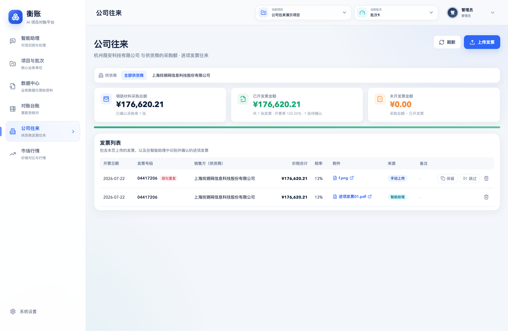
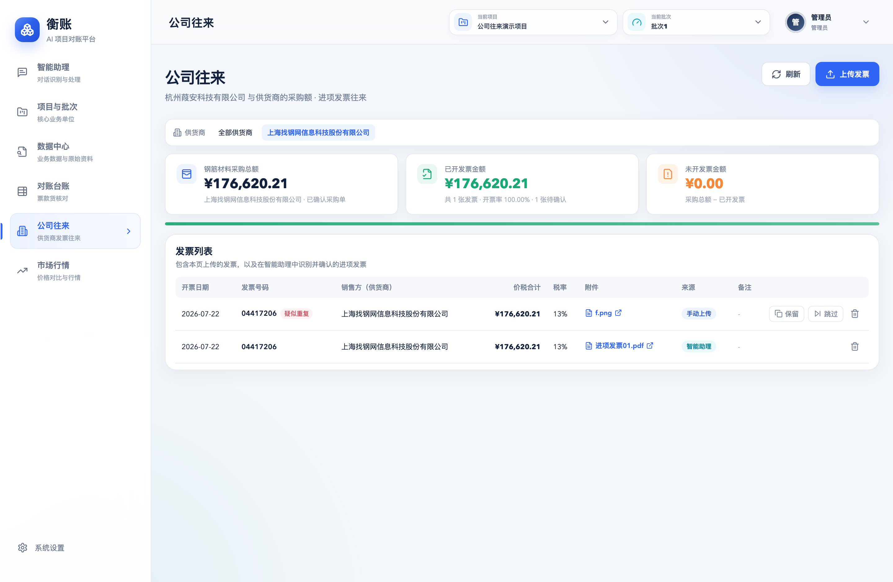
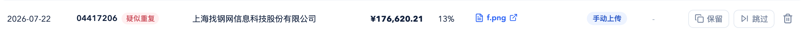
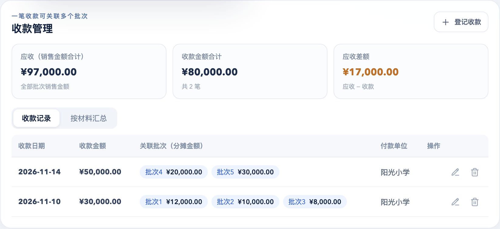
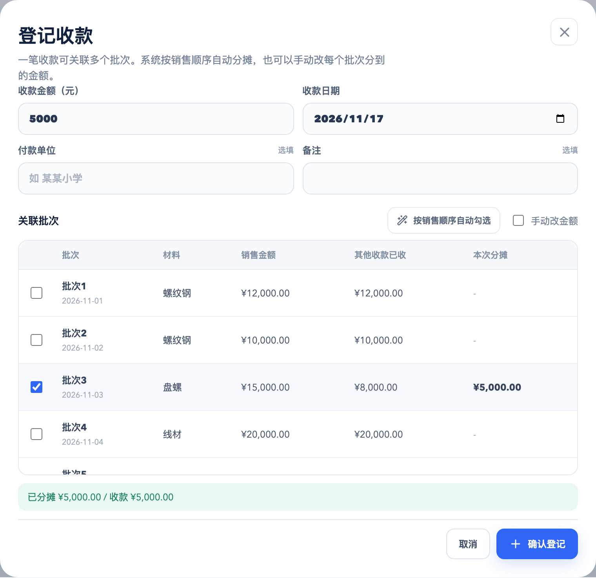
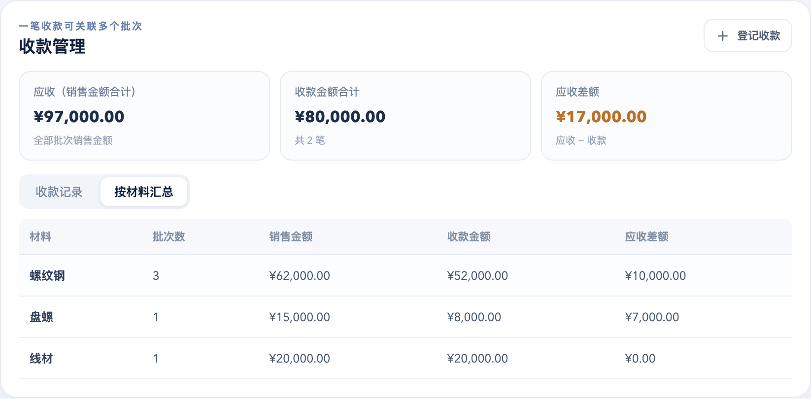
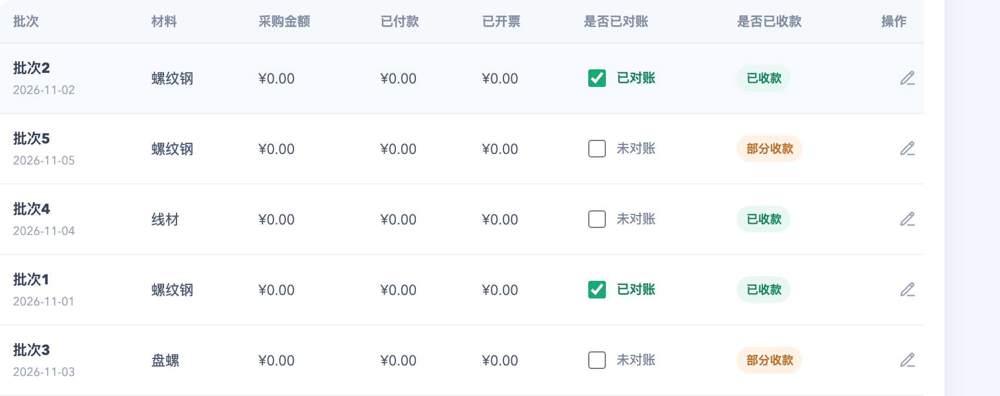
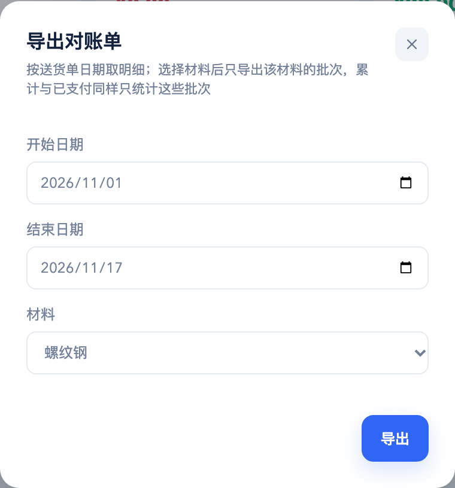
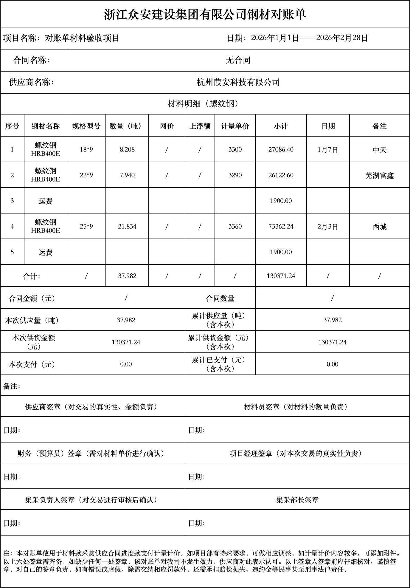

# 项目进展汇报（2026-11-17）

## 一、本周新增内容

### 1. 新增「公司往来」页（核心）

围绕"本公司与供货商的采购额、发票往来"新增独立页面，已按设计稿完成界面，并用真实接口跑通完整业务流。

**页面总览**（导航新增「公司往来」入口，位于对账台账之下）：

- **往来汇总**：钢筋材料采购总额（按已确认采购单统计）、已开发票金额、未开发票金额；发票开多了会标红提示"超开"。
- **开票率进度条**：已开票占采购额的比例，直观看出开票缺口。
- **供货商筛选**：按供货商分别汇总采购额 / 已开票 / 未开票，点选后只看该家的发票：

- **发票列表**：开票日期、发票号码、销售方、价税合计、税率、附件（可点开原件）、来源（页面上传 = 手动上传 / 智能助理识别）、备注，支持删除（删除后台账金额同步回退）。
- **上传发票**：页内一键上传（图片 / PDF / OFD / XML，支持多选），AI 自动识别发票要素；识别结果先"待确认"，核对后点"确认入账"才计入汇总并写入台账；同一张发票重复上传提示"疑似重复"，可保留或跳过：

### 2. 项目收款：一笔收款关联多个批次

以「阳光小学项目」为例（5 个批次，销售金额合计 ¥97,000），一笔 3 万关联批次 1–3，下一笔 5 万只关联批次 4–5：

- **应收**（全部批次销售金额合计）、**收款金额合计**、**应收差额**三个数字一目了然；收多了差额标红。
- 每笔收款下方直接列出关联到哪几个批次、每个批次分到多少钱。
- 登记收款时可「按销售顺序自动勾选」：系统从第一个没收齐的批次开始依次补齐，钱不够时最后一个批次为"部分收款"，没勾选的批次不受影响（下图 5000 元自动落到批次 3 的缺口上）：

- **按材料汇总**：按批次创建时填写的材料分别汇总销售、收款与应收差额：

- 批次列表同步调整：新增「是否已对账」（人工勾选，可不勾）、「是否已收款」（未收款 / 部分收款 / 已收款），去掉原来的「对账进度」：

### 3. 对账单按材料导出 + 新版样式

- 导出对账单时可按材料（如螺纹钢 / 盘螺）筛选，只导出该材料批次的送货单，累计数、已支付同样只统计这些批次；Web 台账页、聊天卡片、小程序均已支持：

- 对账单样式改为客户"钢材对账单"格式：钢材名称两行（大类 / 牌号）、规格"18*9"格式、运费独立行、备注写产地或品牌（不再放送货单图片）：

## 二、验证情况

- 收款：登记 / 修改 / 删除、按销售顺序分摊、超收差额、批次删除保护、来源单据同步，单测与实际接口全流程均通过。
- 公司往来：新增接口与汇总规则单测通过；实际接口全流程（上传 → 识别 → 确认 → 汇总 → 删除回退 → 重复处理）通过。
- 对账单：6 个导出用例通过；用真实数据分别导出"螺纹钢 / 盘螺 / 全部材料"，张数、金额、样式均核对一致。
- 后端全量 147 个测试，仅存 4 个历史遗留失败，无新增失败；前端构建通过；页面浏览器实测无报错。

## 三、当前状态与后续计划

- **已完成**：公司往来页开发与自测、对账单按材料导出与新样式、收款多批次关联与汇总。改动均在功能分支，待整体回归后提交合并。
- **待办**（计划周三前完成）：
  1. 用真实采购单 + 发票数据做一遍验收（当前页面截图为本地演示数据）；
  2. 待确认发票的批量确认体验优化；
  3. 小程序端补齐对账单材料筛选入口的回归确认。
- **周三（11 月 18 日）同步进度**：现场演示公司往来页与收款完整流程（上传 → 确认 → 汇总、登记收款 → 自动分摊 → 差额），并确认剩余事项；整体仍以本周内完成验收交付为目标。

> 说明：发票识别依赖 AI 能力，当前本地环境为模拟模式，截图中的发票金额为模拟识别的演示数据；接入真实识别 Key 后即可生效（配置项已就绪，无需改代码）。收款截图为按真实业务规则录入的演示数据。
