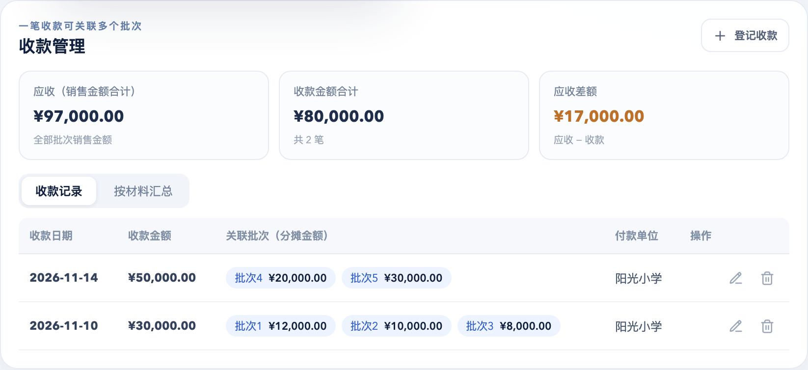
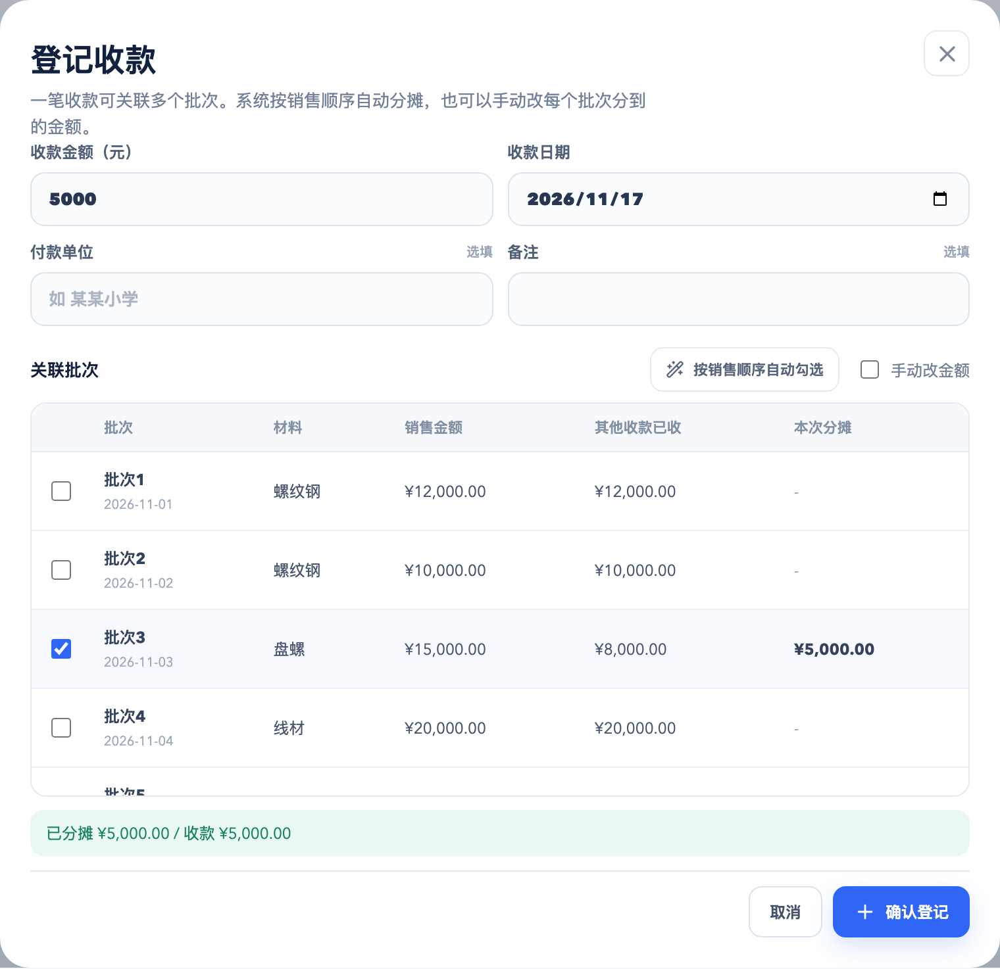
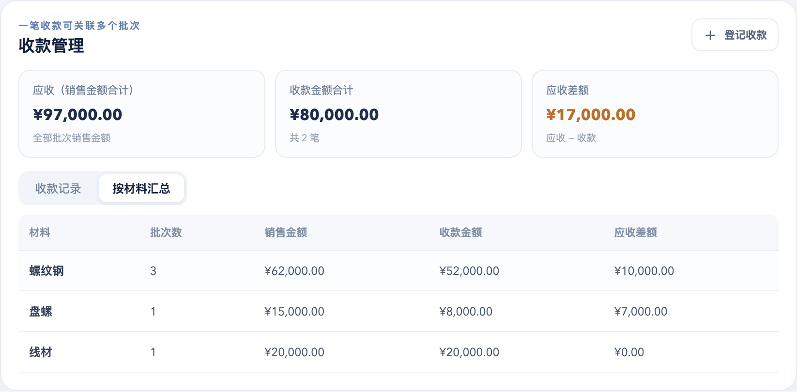
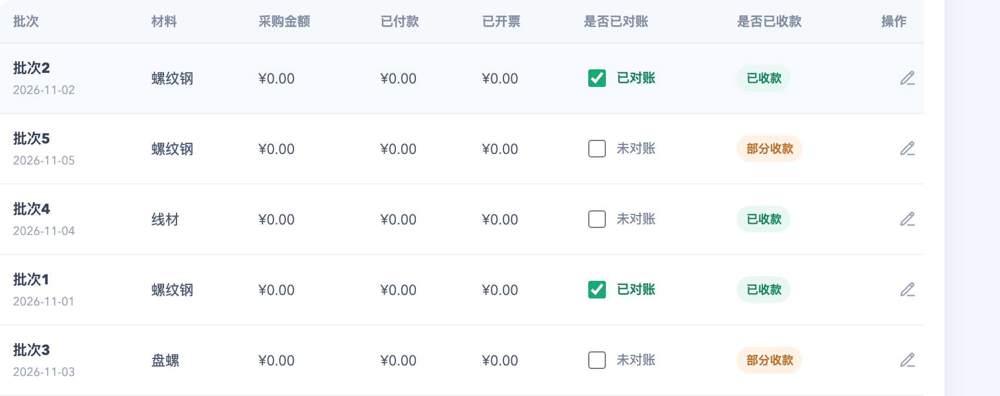
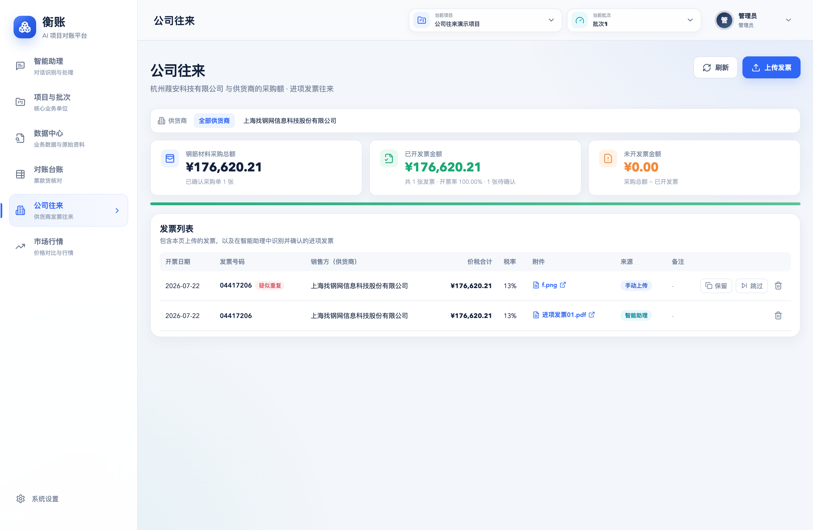
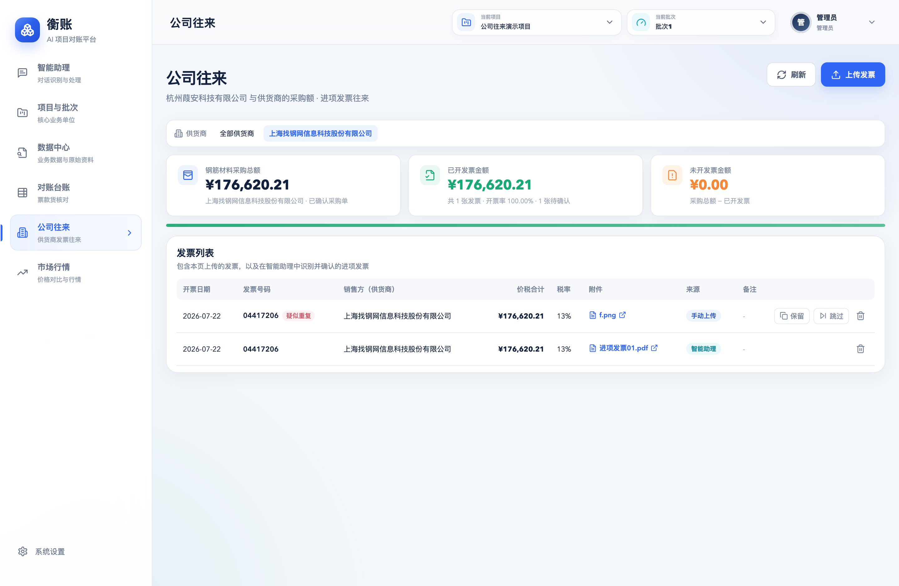
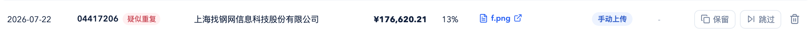
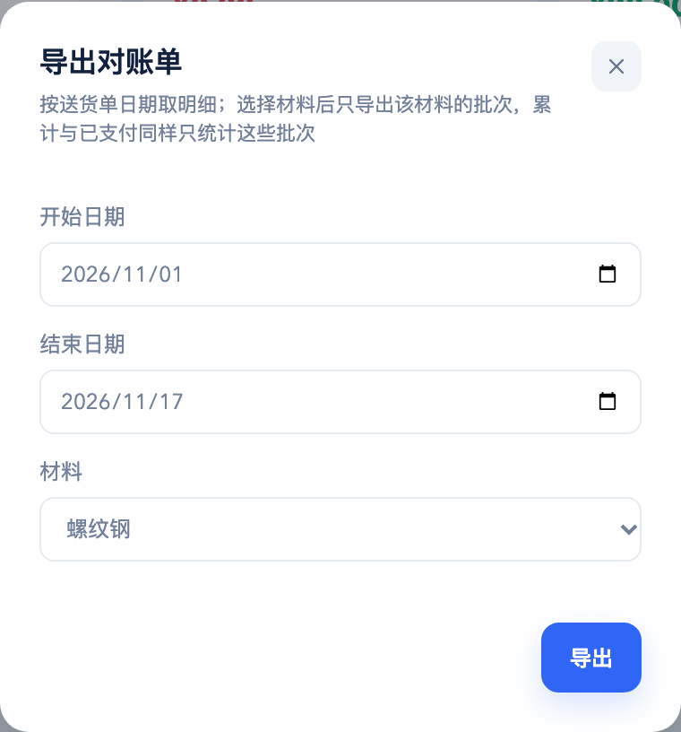
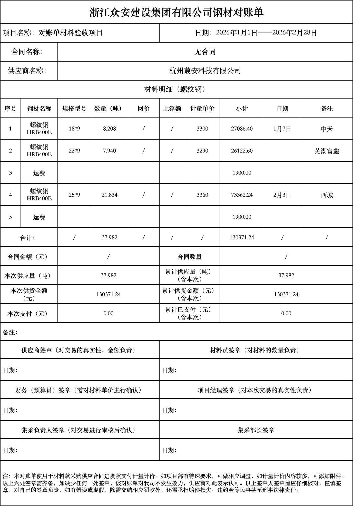

# 项目阶段汇报（截至 2026-11-17）

> 汇报范围：本轮四项需求（收款关联多批次、收款边界修复、对账单按材料导出与新样式、公司往来页）的开发、验证与进度。
> 下次同步：**周三 11 月 18 日**。

---

## 一、总览

| # | 需求 | 状态 | 说明 |
|---|---|---|---|
| 1 | 一笔收款关联多个批次（含修改金额、汇总、应收差额） | ✅ 已完成并自测 | 11-15 开发，11-16 补齐边界 |
| 2 | 收款三项边界修复（来源单据同步 / 删除保护 / 差额口径） | ✅ 已完成并自测 | 31 项定向测试 + 20 项接口检查通过 |
| 3 | 对账单按材料导出 + 客户钢材对账单样式 | ✅ 已完成并自测 | Web 台账页、聊天卡片、小程序共 4 个入口 |
| 4 | 新增「公司往来」页（与供货商的发票往来） | ✅ 已完成并自测 | 按设计稿实现，全流程跑通 |

四项功能均在功能分支 `feat/project-receipts-multi-batch`，已提交 2 个 commit，最新一波改动（对账单、公司往来）待整体回归后提交合并。

---

## 二、功能详情

### 1. 项目收款：一笔收款关联多个批次

业务场景：小学项目里，批次 1、2、3 合计收款 3 万，三个批次都与这 3 万关联；下次再收 5 万只关联批次 4、5。

- **汇总**：应收（全部批次销售金额）、收款金额合计、应收差额三个数字一眼可见，收多了差额标红。
- **关联明细**：每笔收款直接显示关联哪几个批次、每个批次分到多少钱。
- **按销售顺序自动分摊**：登记时一键勾选，从第一个没收齐的批次开始依次补齐；钱不够时最后一个批次为"部分收款"；未勾选的批次不受影响：

- **按材料汇总**：按批次创建时填写的材料分别统计销售、收款、差额：

- **批次列表**：新增「是否已对账」（人工勾选）、「是否已收款」（未收款 / 部分收款 / 已收款），去掉原「对账进度」：

**补齐的三处边界问题：**

1. **收款与来源单据双向同步**：在收款管理里改金额 / 日期 / 付款方，会同步写回数据中心单据和聊天卡片；之后只改原单备注也不会把金额退回旧值。原始附件保持不变。
2. **删除保护**：有收款关联的批次禁止直接删除，删项目也无法绕过，需先解除关联；来源收款单仍从数据中心删除。
3. **两种差额口径分开**：应收差额 = 销售 − 收款（可为负，超收标红）；剩余应收 = 差额最低取 0。项目页、台账、导出文案已统一。

### 2. 公司往来页（本轮新增，核心）

导航新增「公司往来」，围绕"本公司与供货商的采购额、发票往来"独立成页。

- **三张汇总卡**：钢筋材料采购总额（按已确认采购单）、已开发票金额、未开发票金额；发票开多了标红提示"超开"。下方是开票率进度条。
- **供货商筛选**：按供货商分别汇总，点选后只看该家的发票：

- **发票列表**：开票日期、发票号码、销售方、价税合计、税率、附件（可点开原件）、来源、备注，可删除（台账金额同步回退）。
- **上传发票**：页内一键上传（图片 / PDF / OFD / XML，可多选），AI 识别后先"待确认"，核对后点「确认入账」才计入汇总并写入台账；重复上传提示"疑似重复"，可保留或跳过：

### 3. 对账单：按材料导出 + 客户新版样式

- **按材料导出**：导出时可选材料（螺纹钢 / 盘螺等），只导出该材料批次的送货单；累计供应量、累计供货金额、已支付都同口径，不会混入其他材料。四个入口都支持（Web 台账页、Web 聊天卡片、小程序台账页、小程序聊天卡片）：

- **新版样式**：按客户"钢材对账单"格式重做——钢材名称两行（大类 / 牌号）、规格"18*9"、数量（吨）、网价 / 上浮额 / 计量单价 / 小计、日期同天只写首行、运费独立行计入小计、备注写产地或品牌（不再放送货单图片）：

---

## 三、验证情况

| 项目 | 结果 |
|---|---|
| 收款分摊规则单测 | 5 项通过 |
| 收款边界定向回归 | 31 项通过 |
| 收款端到端接口检查 | 20 项通过（含超收、删除保护、事务回滚） |
| 对账单导出用例 | 6 项通过；螺纹钢 + 盘螺 = 全部材料，张数金额核对一致 |
| 公司往来端到端检查 | 15 项通过（上传 → 识别 → 确认 → 汇总 → 删除回退 → 重复处理） |
| 后端全量测试 | 147 个，仅 4 个历史遗留失败（改动前的基线同样失败），无新增 |
| 前端 / 小程序 | TypeScript 校验与生产构建通过；页面浏览器实测无报错 |

---

## 四、后续计划

**待办（计划周三前完成）**

1. 用真实采购单、发票、送货单数据走一遍验收（当前截图数据为本地演示数据）；
2. 待确认发票的批量确认体验优化；
3. 小程序端对账单材料筛选入口的回归确认；
4. 四项功能整体回归后，把未提交改动提交并合并到主干。

**周三（11 月 18 日）进度同步内容**

- 演示：公司往来（上传发票 → 确认入账 → 汇总）、收款（登记 → 自动分摊 → 差额）、对账单（选材料 → 导出）；
- 汇报验收结果与遗留问题，确认下一步排期。

---

## 五、需要说明的前提

- **发票识别为 AI 能力**：当前本地环境为模拟模式，截图中的发票金额是模拟识别结果，接入真实识别 Key 后即生效，配置已就绪、无需改代码。
- **材料名称需一致**：对账单按材料筛选依赖批次创建时填写的材料名，写法统一（如都写"螺纹钢"）才能准确筛选。
- **收款截图数据**：按真实业务规则人工录入（阳光小学项目 5 个批次，销售合计 9.7 万），非智能助理模拟数据。

---

## 附：可直接发群里的文字版

> 项目进展（11 月 17 日）：
> 1、新增「公司往来」页：汇总与各供货商的采购额、已开票、未开票金额，按供货商筛选，支持页内上传发票、AI 自动识别，确认入账后才计入汇总并写入台账。
> 2、项目收款支持一笔收款关联多个批次：可按销售顺序自动分摊，也支持手动调整；可修改金额；支持项目总收款、按材料汇总收款，以及应收与收款差额。
> 3、对账单支持按材料（如螺纹钢、盘螺）筛选导出，样式改为客户要求的钢材对账单格式，备注显示产地或品牌。
> 目前功能开发与自测均已完成，关键场景验证通过，尚未上线；下一步做真实数据验收和整体回归。
> 周三（11 月 18 日）会再同步一次进度并现场演示，目标本周内完成验收交付。
